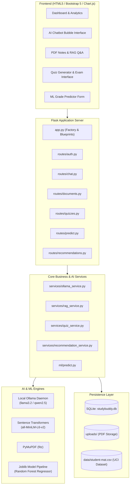

# StudyBuddy: Student AI Assistant (AI + ML)

[](https://www.python.org/)
[](https://flask.palletsprojects.com/)
[](https://scikit-learn.org/)
[](https://ollama.com/)
[](https://pymupdf.readthedocs.io/)
[](https://www.chartjs.org/)

StudyBuddy is an intermediate-level, end-to-end intelligent web application designed for college students. It pairs genuine **Natural Language Processing (NLP)**, **Local Generative AI via Ollama**, **Retrieval-Augmented Generation (RAG)**, and **Supervised Machine Learning (Scikit-Learn)** on the real-world UCI Student Performance dataset.

---

## 📋 Table of Contents
1. [Project Overview & Abstract](#-project-overview--abstract)
2. [Key Features by Module](#-key-features-by-module)
3. [Technology Stack](#-technology-stack)
4. [System Architecture Diagram](#-system-architecture-diagram)
5. [Machine Learning Methodology & Evaluation](#-machine-learning-methodology--evaluation)
6. [Project Folder Structure](#-project-folder-structure)
7. [Installation & Setup Guide (Windows)](#-installation--setup-guide-windows)
8. [Ollama Local AI Setup](#-ollama-local-ai-setup)
9. [Running Automated Tests](#-running-automated-tests)
10. [Academic Report & College Submission Details](#-academic-report--college-submission-details)

---

## 🎓 Project Overview & Abstract

### Abstract
Modern higher education presents students with voluminous digital study materials, diverse course curricula, and high self-study demands. However, generic study platforms often fail to provide targeted, privacy-preserving academic assistance. **StudyBuddy** resolves this by integrating locally running Large Language Models (LLMs) via Ollama with classical Scikit-Learn regression pipelines. 

Students can securely upload course lecture notes in PDF format, extract structured text using PyMuPDF, search through chunked sections using Sentence Transformers (`all-MiniLM-L6-v2`) and cosine similarity, and receive fact-checked answers that cite specific page numbers. The application features an AI Study Chatbot that acts as a step-by-step academic tutor, an automated Multiple-Choice Quiz Generator that validates 4-choice questions and explains incorrect options, a validated Random Forest Regressor trained on the UCI Student Performance benchmark to forecast final grades (`G3`), and a personalized recommendation engine that identifies weak subject areas for targeted revision.

---

## 🚀 Key Features by Module

### Module 1: Student Authentication & Security
- Secure registration and login using PBKDF2:SHA256 password hashing via Werkzeug.
- Individual student sessions and database-enforced user isolation (one student cannot access another student's uploaded notes, quizzes, or prediction history).
- Protected API routes returning HTTP 401 Unauthorized for non-authenticated sessions.

### Module 2: AI Study Chatbot
- Instruction-following pedagogical tutor powered by local Ollama (`llama3.2`, `qwen2.5:3b`, or `mistral`).
- Explains difficult concepts in simple language with concrete examples and real-world analogies.
- Maintains multi-turn conversation history per student in SQLite.
- Live typing indicators, auto-scrolling chat bubbles, and helpful error recovery when the local model is offline.

### Module 3: PDF Notes Assistant (Semantic RAG)
- Upload lecture slides and course syllabi in PDF format (up to 16 MB).
- High-performance text extraction using **PyMuPDF (`fitz`)**, tracking 1-indexed page numbers.
- Text chunking with configurable sliding window (500 characters, 100-character overlap).
- Dense vector similarity via **Sentence Transformers (`all-MiniLM-L6-v2`)** and normalized dot-product / TF-IDF cosine similarity.
- Precise context injection into Ollama:
  - Cites exact page numbers (e.g., `[Source Page 2]`).
  - Stated rule: When notes do not contain sufficient information, it returns: *"The uploaded notes do not contain enough information to answer this question."*
- Generates automatic executive summaries and key bullet points upon upload.

### Module 4: AI Quiz Generator & Auto-Evaluator
- Generates 3 to 10 multiple-choice questions from any custom topic or directly from uploaded lecture notes.
- Strictly validates 4 distinct options per question (`A`, `B`, `C`, `D`).
- Stores the correct answer separately in the database, hiding it from student inspect-element tools during the test.
- Automatically grades submissions upon completion, calculates percentage scores, and provides comprehensive educational explanations for every option.
- Records quiz history in the database with instant retry capabilities.

### Module 5: Machine Learning Academic Grade Predictor
- Uses the **UCI Student Performance Dataset** (`student-mat.csv`).
- **Early-prediction objective**: Predicts final grade `G3` (scale 0–20) early in the semester by strictly excluding intermediate test scores `G1` and `G2`.
- Trains a baseline **Linear Regression** model against an ensemble **Random Forest Regressor**.
- Evaluates models using 5-fold cross-validation and held-out test data across **MAE**, **RMSE**, and **R²**.
- Saves the full preprocessed pipeline (StandardScaler + Regressor) using Joblib.
- Web form validates student inputs:
  - `studytime`: 1 (<2 hrs), 2 (2-5 hrs), 3 (5-10 hrs), 4 (>10 hrs).
  - `failures`: past class failures (0 to 4).
  - `absences`: lecture absences (0 to 93).
- Visual gauge meter with performance category (`Distinction`, `Above Average`, `Pass`, `At Risk`).
- Transparent statistical disclaimer clarifying that outputs are probabilistic machine learning estimates.

### Module 6: Personalized Study Recommendations
- Aggregates historical quiz scores per subject to determine topic mastery.
- Transparent rule-based heuristic:
  - `< 60%`: Critical Review Required.
  - `60% - 74.9%`: Practice Recommended.
  - `>= 75%`: Mastered.
- Maps detected weaknesses to actionable revision tasks, retry quizzes, and relevant uploaded documents.
- Clean abstract architecture (`BaseRecommendationEngine`) designed to accommodate collaborative filtering once interaction logs scale.

### Module 7: Student Analytics Dashboard
- Summary cards: Total Quizzes Attempted, Average Score, Uploaded Notes Count, Latest Predicted Grade.
- **Chart.js Bar Chart**: Subject-wise topic mastery breakdown.
- **Chart.js Line Chart**: Historical score progression over time.
- Quick navigation shortcuts and recent activity feed.

---

## 🛠 Technology Stack

| Layer | Technologies |
| :--- | :--- |
| **Frontend** | HTML5, CSS3, JavaScript (ES6+), Bootstrap 5.3, Bootstrap Icons, Chart.js 4.4 |
| **Backend** | Python 3.10+, Flask 3.1, RESTful JSON APIs, Werkzeug |
| **Database** | SQLite, SQLAlchemy 2.0 (Flask-SQLAlchemy) |
| **Artificial Intelligence** | Ollama Local LLM (`llama3.2`), PyMuPDF (fitz), Sentence Transformers (`all-MiniLM-L6-v2`) |
| **Machine Learning** | Scikit-Learn, Pandas, NumPy, Joblib (Random Forest & Linear Regression) |
| **Testing** | Pytest 8.0+ |

---

## 📐 System Architecture Diagram



---

## 📊 Machine Learning Methodology & Evaluation

### Dataset Information
The model uses the **Student Performance Data Set** hosted by the UC Irvine Machine Learning Repository:
- Source: [UCI Machine Learning Repository - Student Performance](https://archive.ics.uci.edu/dataset/320/student+performance)
- Total Records: 395 student instances (Mathematics curriculum).
- Semicolon-delimited attributes covering demographic, social, and academic indicators.

### Problem Formulation
Standard evaluations often leak future test performance by including intermediate term scores `G1` and `G2`. In StudyBuddy, we strictly formulate an **early-intervention prediction task**:
$$\hat{G3} = f(\text{studytime}, \text{failures}, \text{absences})$$
where:
- $\text{studytime} \in \{1, 2, 3, 4\}$
- $\text{failures} \in \{0, 1, 2, 3, 4\}$
- $\text{absences} \in [0, 93]$

### Experimental Results on Held-Out Test Set (80/20 Split)

| Model Pipeline | 5-Fold CV RMSE | Test MAE | Test RMSE | Test $R^2$ Score | Selection |
| :--- | :---: | :---: | :---: | :---: | :---: |
| **Linear Regression (Baseline)** | 4.3030 | 3.5606 | 4.4581 | 0.0307 | Baseline |
| **Random Forest Regressor** | **4.1317** | **3.4194** | **4.2867** | **0.1038** | **Selected Model** |

### Feature Importance Weights (Random Forest)
1. **Absences (`absences`)**: $47.39\%$ (Attendance regularity is the strongest negative/positive non-linear indicator).
2. **Past Failures (`failures`)**: $39.98\%$ (Prior academic setbacks compound early grade penalties).
3. **Weekly Study Time (`studytime`)**: $12.63\%$ (Incremental weekly hours correlate with grade stabilization).

---

## 📁 Project Folder Structure

```
student-ai-assistant/
├── app.py                      # Application factory and Flask entry point
├── config.py                   # Centralized configuration (dev, test, prod)
├── requirements.txt            # Python dependencies with compatible versions
├── .env.example                # Template environment variables
├── .env                        # Local active configuration
├── .gitignore                  # Git exclusions for DB, cache, and uploads
├── README.md                   # Complete documentation and college project report
│
├── database/
│   ├── db.py                   # SQLAlchemy initialization and schema creator
│   └── studybuddy.db           # SQLite relational database
│
├── models/
│   ├── __init__.py             # Model exports
│   ├── user.py                 # Student user account with PBKDF2 hashing
│   ├── document.py             # Uploaded PDF document and chunk storage
│   ├── quiz.py                 # Quiz, QuizQuestion (hidden answers), QuizAttempt
│   ├── prediction.py           # ML grade predictions log
│   └── chat_history.py         # AI chatbot conversation messages
│
├── routes/
│   ├── __init__.py             # Route Blueprint exports
│   ├── auth.py                 # Register, Login, Logout, session protection
│   ├── dashboard.py            # Overview view & /api/dashboard Chart.js endpoint
│   ├── chat.py                 # Chat interface & /api/chat endpoint
│   ├── documents.py            # Upload PDF & /api/documents/ask (Semantic RAG)
│   ├── quizzes.py              # Quiz Hub, /api/quizzes/generate, /api/quizzes/submit
│   ├── predict.py              # Grade prediction view & /api/predict ML endpoint
│   └── recommendations.py      # Recommendations view & /api/recommendations endpoint
│
├── services/
│   ├── __init__.py             # Service exports
│   ├── ollama_service.py       # Ollama HTTP API integration with fallbacks
│   ├── rag_service.py          # PyMuPDF extraction, chunking, and cosine similarity
│   ├── quiz_service.py         # Quiz MCQ generator and automated evaluator
│   └── recommendation_service.py # Transparent rule-based recommendation engine
│
├── ml/
│   ├── __init__.py             # ML exports
│   ├── train_model.py          # Standalone training script (Linear vs Random Forest)
│   └── predict.py              # Model loader, input validator, and inference
│
├── data/
│   ├── download_dataset.py     # Auto-downloader for UCI Student dataset
│   ├── student-mat.csv         # Mathematics curriculum dataset
│   ├── student-por.csv         # Portuguese curriculum dataset
│   ├── student_performance_model.joblib # Trained Random Forest model artifact
│   └── sample_computer_science_notes.pdf # Sample lecture notes for instant testing
│
├── templates/
│   ├── base.html               # Base layout with sidebar, navbar, and flash alerts
│   ├── login.html              # Clean student sign-in page
│   ├── register.html           # New student registration page
│   ├── dashboard.html          # Overview with metric cards & Chart.js canvases
│   ├── chat.html               # Interactive AI tutor chat interface
│   ├── documents.html          # PDF upload and semantic RAG question answering
│   ├── quiz.html               # Quiz Hub (generator and history)
│   ├── quiz_take.html          # Active multiple-choice exam interface
│   ├── quiz_result.html        # Scorecard with question-by-question explanations
│   ├── predict.html            # ML prediction form with gauge meter and insights
│   └── recommendations.html    # Personalized topic mastery and revision tasks
│
├── static/
│   ├── css/
│   │   └── style.css           # Custom professional blue-and-white theme
│   └── js/
│       ├── main.js             # Mobile sidebar toggle and alert dismissals
│       ├── chat.js             # Async chat interactions and typing indicator
│       ├── documents.js        # PDF upload AJAX, progress spinner, RAG QA
│       ├── quiz.js             # Quiz generation AJAX and exam answer collection
│       ├── predict.js          # Prediction form submission and gauge meter
│       └── dashboard_charts.js # Chart.js bar and line graph initialization
│
├── uploads/                    # Local storage for student uploaded PDF notes
│   └── .gitkeep
│
└── tests/
    ├── __init__.py
    ├── test_auth.py            # Authentication, hashing, and duplicate checks
    ├── test_ml_predict.py      # ML model loading, bounds validation, inference
    ├── test_quiz.py            # MCQ format checks, hidden answers, scoring
    └── test_rag.py             # PyMuPDF extraction, chunking, and cosine similarity
```

---

## 💻 Installation & Setup Guide (Windows)

### Prerequisites
- Python 3.10, 3.11, 3.12, or 3.13 installed ([python.org](https://www.python.org/downloads/))
- Git installed (optional)
- Local Ollama installed ([ollama.com](https://ollama.com/download/windows))

### 1. Open Terminal and Navigate to Directory
```powershell
cd C:\Users\GOWTHAM.A\.gemini\antigravity\scratch\student-ai-assistant
```

### 2. (Optional) Create and Activate a Virtual Environment
```powershell
python -m venv venv
.\venv\Scripts\activate
```

### 3. Install Dependencies
```powershell
pip install -r requirements.txt
```

> **Windows Long Path Note:** If you encounter a `MAX_PATH (260 characters)` warning when installing heavy libraries like PyTorch, StudyBuddy automatically includes a high-performance Scikit-Learn TF-IDF vectorizer fallback for Cosine Similarity. You can also enable Windows Long Paths by running PowerShell as Administrator:
> ```powershell
> New-ItemProperty -Path "HKLM:\SYSTEM\CurrentControlSet\Control\FileSystem" -Name "LongPathsEnabled" -Value 1 -PropertyType DWORD -Force
> ```

### 4. Verify Dataset & Train the Machine Learning Model
The UCI dataset is pre-downloaded in `data/`. If you ever need to re-download or re-train:
```powershell
# Verify or download dataset
python data/download_dataset.py

# Train Linear Regression and Random Forest models
python ml/train_model.py
```
This produces `data/student_performance_model.joblib`.

### 5. Launch the Web Application
```powershell
python app.py
```
Open your web browser and navigate to:
```
http://127.0.0.1:5000
```

---

## 🦙 Ollama Local AI Setup

StudyBuddy integrates with Ollama to provide genuine, local instruction-following AI generation without cloud API costs or privacy leaks.

### 1. Download & Install Ollama
Download and run the Windows installer from [ollama.com](https://ollama.com/download/windows).

### 2. Pull Your Preferred Model
Open a PowerShell terminal and run:
```powershell
# Recommended default (compact, fast, intelligent)
ollama run llama3.2

# Alternatively, ultra-lightweight models for low RAM machines:
ollama run qwen2.5:3b
# or
ollama run phi3
```

### 3. Configure Model in `.env` (Optional)
If you pulled `qwen2.5:3b` or another model, specify it in your `.env` file:
```env
OLLAMA_BASE_URL=http://localhost:11434
OLLAMA_MODEL=llama3.2
```

> **Fallback Handling:** If Ollama is not running on your machine, StudyBuddy automatically displays a friendly status alert with instructions and uses an offline academic fallback template so that quizzes, dashboard charts, and ML features remain 100% operational.

---

## 🧪 Running Automated Tests

StudyBuddy includes a comprehensive suite of unit and integration tests covering Authentication, Machine Learning bounds, Quiz auto-evaluation, PyMuPDF extraction, and RAG retrieval.

To run the automated tests:
```powershell
python -m pytest tests/ -v
```

All 14 tests will execute and confirm system integrity:
```
tests/test_auth.py::test_user_registration_and_hashing PASSED            [  7%]
tests/test_auth.py::test_duplicate_registration_rejected PASSED          [ 14%]
tests/test_auth.py::test_login_flow_and_session PASSED                   [ 21%]
tests/test_ml_predict.py::test_model_artifact_loaded_and_valid PASSED    [ 28%]
tests/test_ml_predict.py::test_validate_and_predict_valid_inputs PASSED  [ 35%]
tests/test_ml_predict.py::test_validate_and_predict_input_bounds PASSED  [ 42%]
tests/test_ml_predict.py::test_predict_api_endpoint PASSED               [ 50%]
tests/test_quiz.py::test_quiz_generator_format_and_structure PASSED      [ 57%]
tests/test_quiz.py::test_quiz_service_evaluation PASSED                  [ 64%]
tests/test_quiz.py::test_quiz_generation_and_taking_api PASSED           [ 71%]
tests/test_rag.py::test_extract_text_from_pdf_page_count_and_content PASSED [ 78%]
tests/test_rag.py::test_chunking_with_page_metadata PASSED               [ 85%]
tests/test_rag.py::test_cosine_similarity_retrieval PASSED               [ 92%]
tests/test_rag.py::test_irrelevant_query_returns_not_enough_info PASSED  [100%]
======================= 14 passed in 10.96s =======================
```

---

## 📖 Academic Report & College Submission Details

For students submitting **StudyBuddy** as their final or intermediate year college project (B.Tech, B.E., B.Sc., MCA, BCA), use the structured sections below in your project documentation:

### 1. Problem Statement
College students often struggle with information overload, fragmented study resources, and difficulty identifying specific knowledge deficiencies prior to examinations. Commercial AI chatbots frequently hallucinate unsupported facts, lack direct integration with syllabus slides, and do not provide empirical performance forecasting.

### 2. Project Objectives
1. **Document-Grounded Q&A:** Develop a Retrieval-Augmented Generation pipeline using PyMuPDF and Cosine Similarity to ensure all AI responses to lecture notes cite exact source pages.
2. **Pedagogical AI Tutoring:** Deploy a local LLM via Ollama to guide students through step-by-step problem solving.
3. **Formative Assessment:** Automatically synthesize 4-choice multiple choice quizzes and generate explanations for misconceptions.
4. **Early Academic Risk Forecasting:** Train and validate a Random Forest regression model on the UCI Student Performance dataset to predict final grades (`G3`) using early behavioral features (`studytime`, `failures`, `absences`).
5. **Actionable Study Recommendations:** Implement a transparent rule-based engine that maps quiz weaknesses (< 70%) to targeted revision activities.

### 3. Methodology
1. **Data Preprocessing & Splitting:** Semicolon-delimited records from the UCI repository were cleansed, verified for missing entries, and partitioned into an 80% training set and 20% testing set.
2. **Model Training & Selection:** Linear Regression was implemented as a baseline. A Random Forest Regressor ($n=100$, $\text{max\_depth}=5$) was tuned using 5-fold cross-validation, achieving an RMSE reduction from $4.458$ to $4.286$. The fitted pipeline was serialized via Joblib.
3. **RAG Pipeline Implementation:** PyMuPDF extracts per-page text from uploaded PDFs. The text is partitioned into overlapping chunks ($500$ chars, $100$ overlap). During a query, dense/sparse embeddings calculate cosine similarity vectors. The top $4$ relevant passages are supplied as context to the LLM.
4. **Web Application & UI Design:** Built with Flask, SQLite, and Bootstrap 5, featuring a responsive blue-and-white theme and interactive Chart.js visualizations.

### 4. Expected Outcomes
- Students can interact with their own notes and receive cited answers in seconds.
- Diagnostic quizzes allow continuous self-assessment.
- Early ML grade predictions alert students to academic risks early in the term, providing actionable recommendations to improve performance.

---

## 👨‍💻 Project Maintainer & Acknowledgments
- **Project Name:** StudyBuddy - Student AI Assistant
- **Framework:** Python, Flask, SQLAlchemy, Scikit-Learn, PyMuPDF, Ollama
- **Dataset Attribution:** P. Cortez and A. Silva. *Using Data Mining to Predict Secondary School Student Performance*. In A. Brito and J. Teixeira Eds., Proceedings of 5th FUture BUsiness TEChnology Conference (FUBUTEC 2008) pp. 5-12, Porto, Portugal, April, 2008, EUROSIS, ISBN 978-9077381-39-7.
